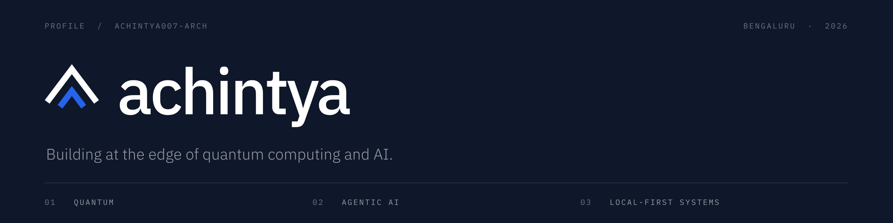

 

**I build things at the edge of quantum computing and AI, and I play loud guitar in between.**

 

 

**Achintya Akella**: B.Tech CS '27 at GITAM, Bengaluru. Quantum researcher, systems builder, songwriter.
I'm working toward an MS in quantum computing and, eventually, a company building quantum-native AI infrastructure. This page is the trail so far.

 

## ⚛️ What I'm building

<table>
<tr>
<td width="50%" valign="top">

### [Q-Folio](https://github.com/achintya007-arch/qfolio)
Picking the best *k* of *n* stocks with QAOA, with the constraint kept **inside** the circuit instead of bolted on as a penalty. Run on real IBM quantum hardware.

`Qiskit` `QAOA` `IBM Quantum`
**[Interactive report →](https://achintya007-arch.github.io/qfolio/)**

</td>
<td width="50%" valign="top">

### [JARVIS](https://github.com/achintya007-arch/JARVIS)
A voice assistant that never phones home. Wake word, local LLM, tool use and desktop control, all on my own machine.

`Python` `C#` `Ollama` `Local AI`

</td>
</tr>
<tr>
<td width="50%" valign="top">

### [Quantum Graph Coloring](https://github.com/achintya007-arch/quantum-graph-coloring)
An NP-hard problem attacked three ways: greedy, QAOA, and quantum-inspired. QUBO → Ising → solvers.

`QUBO` `QAOA` `Python`

</td>
<td width="50%" valign="top">

### [DentalFlow AI](https://github.com/achintya007-arch/DentalAI)
An AI receptionist on WhatsApp for dental clinics: instant replies, bookings, reminders, follow-ups.

`Next.js` `Prisma` `OpenAI`

</td>
</tr>
<tr>
<td width="50%" valign="top">

### [TheoryMap](https://github.com/achintya007-arch/TheoryMap)
Music theory as a connected knowledge graph, built for guitarists.

`Next.js` `Knowledge graph`

</td>
<td width="50%" valign="top">

### Quantum Circuit Optimizer *(capstone, in progress)*
Cuts two-qubit gates **after** routing, and proves the optimized circuit still does the same thing.

`Python` `Qiskit` `MQT QCEC`

</td>
</tr>
</table>

 

## 🧭 How I work

- **Local first.** I like systems that run on my own hardware, with no cloud dependency.
- **Honest numbers.** I'd rather ship it, measure it, and report what happened. If there's no quantum advantage, the README says so.
- **AI-assisted, and I say so.** I use AI coding tools heavily. I choose the problem, design the experiments, run the hardware jobs, and check the results.

 

## 🚀 The long game

I think quantum computing will change how we explore space, discover materials and run intelligent systems. I want to be one of the people who builds the infrastructure that makes that real.

 

## 🎸 Beyond the code

- Guitarist and songwriter, frontman of **Crimson**, a hard rock and blues rock band
- PADI Open Water diver
- I build tools for the thing I love, which is why TheoryMap exists

 

## 🛠️ Stack

`Qiskit` · `Ollama` · `OpenAI API` · `FastAPI`

 

**[Website](https://achintya-akella.vercel.app/)** · **[LinkedIn](https://www.linkedin.com/in/akella-achintya/)** · **[GitHub](https://github.com/achintya007-arch)**

